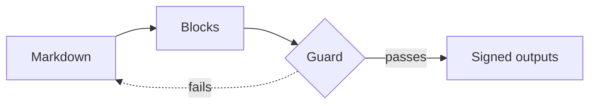

# LibKa block reference

Generated from the block registry (LibKa 2.0.2). Do not edit by hand: `node packages/blocks/src/build-skill.ts`.

## Front matter

```yaml
---
title: Required. The document title (there is no # heading in the body).
subtitle: Optional one-line subtitle.
version: "1.0"      # optional, quoted
date: "2026-10-03"  # optional, quoted
status: Draft       # optional
owner: Platform team        # optional: who keeps it correct
reviewed: 2026-09-01        # optional: last review, YYYY-MM-DD
next-review: 2027-03-01     # optional: review due, YYYY-MM-DD
references:                 # optional: sources cited as [@id]
  - id: wcag22              # letters, digits and - _ : . /
    title: Web Content Accessibility Guidelines (WCAG) 2.2   # required
    author: W3C             # a person as "Doe, Jane"; several as a list
    year: 2023
    publisher: World Wide Web Consortium   # also a journal or website name
    url: https://www.w3.org/TR/WCAG22/
  - id: smith-lee-2024
    title: Attention in Video Meetings
    author: ["Smith, Anna", "Lee, Ben"]   # text: (Smith and Lee, 2024); 3 or more: (Smith et al., 2024)
    year: 2024
lang: en            # en or cs; sets the language of the page text
outputs: [web, pdf, docx]   # optional: what the build makes: web, pdf, deck, docx (default: web and pdf)
---
```

Quote `version` and `date` (YAML would read 1.10 as a number), and any value that contains a colon (`title: "Payments: onboarding"`); `reviewed` and `next-review` work quoted or not. `date` is the publication date as free text ("2026-10-03" or "October 2026"); leave it out when it would only repeat `reviewed`. A reference entry has only the fields shown: `id`, `title`, `author`, `year`, `publisher`, `url`.

`status` is free text (Draft, Approved, Example ...); Approved, Draft and Deprecated get a colored badge, and Deprecated also a fixed banner at the top ("This document is no longer maintained …"); name the document that replaces it once, in the sentence before the first `##`. `date`, `status`, `owner`, `reviewed` and `next-review` appear under the title, and the last four also in the footer or in a `:::doc-status` panel where you place one. Czech status words get the same badges: Schváleno or Platný, Koncept or Návrh, and Zastaralý (with the banner). `lint` warns when `next-review` has passed.

## Syntax details

- **Nesting:** each level out gets one more colon. A checklist inside a tab inside tabs: `:::::tabs` > `::::tab[Mac]` > `:::checklist`, each closed by a line with the same number of colons.
- **Attribute values** go in double quotes: `caption="Plans and prices"`. To put a double quote inside, wrap the value in single quotes: `source='What "open" means'`. Backslash escapes do not work.
- **Block contents:** callouts, tabs, accordion items, cards, quotes and do/don't items hold ordinary Markdown: paragraphs, lists, links, code, even other blocks, but no headings and no `:::notes`. A quote `source` is plain text; its link goes in `cite`.
- **In-page links:** a heading's id is its text in lower case with hyphens (`## Getting started` → `#getting-started`; repeats get `-2`). Glossary terms get `#term-…`. Lint reports links that point nowhere.
- **Outputs:** tabs are keyboard tabs on the web page (added by a small script) and every tab is shown in the PDF and on slides; accordions are open in the PDF and on slides. `:::notes` text appears only in the deck: not on the web page, not in the PDF. `outputs` names what the build makes: `web` (the page), `pdf` (its A4 PDF), `deck` (16:9 slides) and `docx` (an editable Word file); leave it out for the web page and the PDF, and add `deck` when the content will be presented. The PDF and the Word file need `web`. In the Word file tabs and accordions are open, diagrams, charts and UI specimens are pictures with their text alternative (a chart's data follows as a table), and footnotes are Word footnotes.
- **GitHub alerts:** `> [!NOTE]`, `> [!TIP]`, `> [!IMPORTANT]`, `> [!WARNING]` and `> [!CAUTION]` quotes become callouts; text after the marker on the same line is the title. More than 2 callouts in one `##` section get a lint hint.
- **Notes and sources:** footnote definitions (`[^name]: ...`) go at the top level, best at the end, never inside a block. Every cited `[@id]` must be in `references` and every entry cited. Notes, and the reference list when there is no `:::references`, are added at the end by the build: do not write a "Notes" or "References" section yourself. `:::references[Title]` makes its own section heading (and slide) where it stands, usually after the last `##`, with no heading of your own above it. A footnote marker goes after the punctuation and after a citation: `…better [@smith-lee-2024].[^1]`. Write authors who are people as "Doe, Jane" so the author-date style shows "Doe"; an organisation is written as is.
- **Diagrams:** `accTitle:` and `accDescr:` go right after the first line in every type (`sequenceDiagram`, then `accTitle: ...`, then `participant` lines). `accDescr` is the text alternative: one lead sentence beside the diagram is enough, do not repeat the whole description as body text. On a slide the diagram takes the space left under the heading and text; slides are wide, so prefer `flowchart LR` and `direction LR` in state diagrams, and give long prose its own `###` when Guard reports the slide as too full.
- **Contents:** a manual with two or more `##` sections gets contents at the top by itself. It cannot be switched off; `:::toc` only moves it and sets its depth.
- **Heading ids** drop accents and punctuation, and a dot inside a word becomes a hyphen: `## Výběr datových sad` → `#vyber-datovych-sad`, `## U.S. imports` → `#u-s-imports`. When unsure, run lint: it names the id it expected.
- **FAQ:** one `::::accordion` per topic is fine, also with a single item; split a long FAQ into topics with `###`.
- **Release notes:** say a change once: a dropped platform goes in `:::removed`, and in a notice before the groups only when the reader must act. A `###` after a release continues it on its own slide (for example migration notes). Each `::::release` is a `##` heading. Drop the source's grouping heading ("What changed", "Changelog") when the versions follow it directly; in a document with other topics, open the versions with `:::section[What changed]`.
- **Parts:** `:::section[Part 2: Results]` is a level-2 heading that groups the `##` sections after it; it stands at the top level, never inside another block.
- **Slides:** every `##` and `###` is a slide, numbered from 1 = the title slide; a `:::section` is a slide of its own, and so is a `:::summary` placed before the first `##`. A slide holds about 120 words, less with figures, charts or UI specimens. `lint` warns when a slide is probably too full. The build measures every slide and fits it: a little overflow is shrunk (to 85% at most), more is continued on a "(continued)" slide, and long steps, lists, tables, description lists, accordions, cards and the contents agenda continue item by item (steps and the agenda keep counting; an agenda slide holds about 10 sections and parts). An accordion question that alone is taller than a slide is opened on the slides: the question becomes a subheading and the answer continues paragraph by paragraph. Only a block it cannot split that is taller than a slide fails: a do-and-don't pair, a long code block or code group, a chart or diagram with text around it.

## Choose a block

| Content looks like | Block |
|---|---|
| The content has parts a reader scans for or a presenter moves between: one ## per topic, ### per sub-topic (each becomes a slide). | Heading (`heading`) |
| Explanation, context or argument in sentences. The default; most content is paragraphs. | Paragraph (`paragraph`) |
| Three or more parallel items without an order (bulleted) or with one (numbered, when not instructions). | List (`list`) |
| Key-value facts read as pairs: document or invoice details, specifications, contact data, CV facts. | Description list (`dl`) |
| Policies, procedures, specifications and any page readers must trust: who owns it, when it was last reviewed, when the next review is due, and whether it is still valid. | Document status (`doc-status`) |
| Long documents where readers jump to a section, or a deck that opens with an agenda. Manuals already get contents by themselves; place :::toc to choose where they go and how deep. | Table of contents (`toc`) |
| A report, proposal or study that cites sources with `[@id]`; place the list where it belongs and choose its style. Without the block the list is added at the end. | References (`references`) |
| Release notes or a changelog: what changed in each version, grouped as added, changed, deprecated, removed, fixed and security (Keep a Changelog). | Release notes (`release`) |
| A long document or deck with parts or chapters, each grouping several ## sections ("Part 2: Results"). | Section divider (`section`) |
| Commands, file contents, configuration or source code that a reader types or copies. | Code (`code`) |
| The same command or snippet in several variants a reader chooses between: npm, pnpm and yarn; Python and JavaScript; Windows and macOS shells. | Code group (`code-group`) |
| One message the reader must not miss: a prerequisite (info), a risk (warning), a success criterion or a failure; or guidance: a side note, a tip, something important, a caution before an action. | Callout (`callout`) |
| A task the reader performs in order: "Install", "Configure", "Run". Each step starts with a verb. | Steps (`steps`) |
| Things to verify or tasks to tick off, such as "before you publish" or acceptance criteria. | Checklist (`checklist`) |
| The same task or content differs by platform, language, role or plan, and each reader needs only one variant. | Tabs (`tabs`) |
| Questions and answers (FAQ), or optional detail most readers can skip. | Accordion / FAQ (`accordion`) |
| Keyboard shortcuts or key combinations and what they do. | Keyboard shortcuts (`shortcuts`) |
| Terms the audience may not know, defined once and linkable. | Glossary (`glossary`) |
| A process, a sequence of messages, states and transitions, a class model or a data model that a picture explains better than a list: flowcharts, sequence, state, class and entity-relationship diagrams. | Diagram (`diagram`) |
| Guidance with a right and a wrong way: writing style, UI labels, design rules. | Do and don't (`compare`) |
| Words from a person or a source, quoted with attribution: a customer, a standard, a law. | Quote (`quote`) |
| Pointers to related pages, products, options or next steps, each with a title and one sentence. | Cards (`cards`) |
| The single most important message of a section or slide, in one sentence. | Statement (`statement`) |
| Two to four headline numbers with what they mean: results, targets, KPIs. | Key figures (`metrics`) |
| Three to five key points a busy reader needs first: the top of a report, a proposal or a long page. Mark it source=ai when an AI wrote it, with the person who checked it. | Summary (`summary`) |
| The one next step at the end of a section, page or deck: start the tutorial, book a demo, download the template. | Call to action (`cta`) |
| A diagram, screenshot, photo or illustration that carries information. | Figure (`figure`) |
| Several related images to compare or browse, each with its own caption. | Gallery (`gallery`) |
| A recording that shows something better than text: a walkthrough, a demo, a talk. | Video (`video`) |
| Data with rows and columns that readers look up or compare: versions, prices, specifications. | Table (`table`) |
| Dated events or phases in order: a roadmap, a project plan, a history, CV experience. Mark where things stand now with current=. | Timeline (`timeline`) |
| Options, plans or products compared feature by feature, often with one recommended: pricing plans, tool choices, vendor offers. | Comparison table (`comparison`) |
| Numbers whose pattern matters: comparisons between categories (bar), change over time (line), parts of a whole (donut). | Chart (`chart`) |
| Documenting or specifying an interface: which button, field, message or dialog the reader will see. | UI specimen (`ui`) |
| What a presenter should say that does not belong on the slide. | Speaker notes (`notes`) |

## Inside text

- **Key**: Keys and key combinations as key caps; + separates the keys. Example: `Press :kbd[Ctrl+Shift+P].`
- **Badge**: A short status label inside text: neutral, info, success, warning, error or ai. Example: `Export to PowerPoint :badge[Beta]{variant=info}`
- **Footnote**: An aside or a source without breaking the sentence: `[^name]` in the text and `[^name]: the note` on its own line at the top level (the end of the document is best). Notes are numbered by first use and collected under Notes at the end; decks get a Notes slide. Every note must be used and every reference defined. Example:

  ```markdown
  Contrast is measured on the rendered page.[^contrast]

  [^contrast]: Guard also measures with high contrast requested.
  ```

- **Citation**: A source from the front matter references list: `[@id]`, with a page or section after a comma (`[@id, p. 33]`), several separated by ; (`[@a; @b]`). Shown as [1] or (Author, 2023) by the `:::references` style, linked to the list. Recognised only when the front matter has references. Example: `Text alternatives are required for images [@wcag22, sec. 1.1.1].`

## Text

### Heading (`heading`)

Sections (##), subsections (###) and minor headings (####). The title comes from the front matter.

Use it when: The content has parts a reader scans for or a presenter moves between: one ## per topic, ### per sub-topic (each becomes a slide).

```markdown
## Install the tools

### On Windows
```

Slides: ## starts a section slide, ### a slide; #### stays inside its slide.

Avoid:
- A heading used for emphasis instead of a callout or statement.
- Headings inside tabs, accordions or cards (they break the outline and the slides).

### Paragraph (`paragraph`)

Running text with **bold**, *italic*, `code`, links and :kbd[Ctrl+S] keys.

Use it when: Explanation, context or argument in sentences. The default; most content is paragraphs.

```markdown
Press :kbd[Ctrl+S] to save. See the [release notes](https://example.org/notes) for details.
```

Slides: Paragraph on the slide.

Avoid:
- Walls of text on a slide: move them into :::notes.

### List (`list`)

Bulleted (-) or numbered (1.) lists. For instructions use :::steps, for tasks :::checklist.

Use it when: Three or more parallel items without an order (bulleted) or with one (numbered, when not instructions).

```markdown
- Tokens
- Blocks
- Guard
```

Slides: List on the slide.

Avoid:
- Numbered lists for things without an order.

### Description list (`dl`)

Terms and their values in two columns, such as "Owner: Docs team". Values may hold links, e-mail addresses and code. For terms the reader learns, use :::glossary.

Use it when: Key-value facts read as pairs: document or invoice details, specifications, contact data, CV facts.

```markdown
:::dl[Project details]
- **Owner** Platform team
- **Budget** EUR 40,000
- **Deadline** 31 March 2027
:::
```

Slides: Same, on the slide.

Avoid:
- Long paragraphs as values: use headings and text.
- Data with more than one value per term: use a :::table.

### Speaker notes (`notes`)

What the presenter says. Shown only in the deck (notes panel and presenter view).

Use it when: What a presenter should say that does not belong on the slide.

```markdown
:::notes
Mention that the checks run on every build.
:::
```

Slides: Notes panel (N) and presenter view (P).

Avoid:
- Slide text copied into the notes.

## Document

### Document status (`doc-status`)

Status, owner and review dates. Front matter keys status, owner, reviewed and next-review show them under the title and in the footer by themselves; :::doc-status places them as a panel where you want it (and may set them itself).

Use it when: Policies, procedures, specifications and any page readers must trust: who owns it, when it was last reviewed, when the next review is due, and whether it is still valid.

```markdown
:::doc-status{owner="Platform team" reviewed=2026-09-01 next-review=2027-03-01}
:::
```

Attributes:
  - `status`: Draft, Approved, Deprecated ... (or set it in front matter). Deprecated shows a banner at the top.
  - `owner`: Who keeps the document correct: a team or a role.
  - `reviewed`: Date of the last review, YYYY-MM-DD.
  - `next-review`: When the next review is due, YYYY-MM-DD; lint warns once it has passed.

Slides: Title slide footer line.

Avoid:
- The same key in front matter and in the block with different values (reported).
- A next-review date nobody acts on: lint warns when it has passed.

### Table of contents (`toc`)

The contents, placed where it stands: ## sections and parts (depth=2, the default) or also ### subsections (depth=3). It replaces the automatic contents; in a deck it is an agenda.

Use it when: Long documents where readers jump to a section, or a deck that opens with an agenda. Manuals already get contents by themselves; place :::toc to choose where they go and how deep.

```markdown
:::toc[Contents]{depth=3}
:::
```

Attributes:
  - `depth`: 2 lists ## sections and parts, 3 adds ### subsections. One of: 2, 3.

Slides: An agenda of the ## sections and parts; its own slide when it comes before the first ##.

Avoid:
- Contents in a short document with two or three sections.
- Depth 3 on slides: the agenda shows sections only.

### References (`references`)

The list of cited sources, from the front matter references, in numeric ([1]) or author-date ((W3C, 2023)) style. Without the block, a numeric list is added at the end.

Use it when: A report, proposal or study that cites sources with `[@id]`; place the list where it belongs and choose its style. Without the block the list is added at the end.

In the front matter:

```yaml
references:
  - id: wcag22
    title: Web Content Accessibility Guidelines (WCAG) 2.2
    author: W3C
    year: 2023
    url: https://www.w3.org/TR/WCAG22/
```

In the text:

```markdown
Images need a text alternative [@wcag22].

:::references[Sources]{style=author-date}
:::
```

Attributes:
  - `style`: numeric: [1] in the text and a numbered list (default); author-date: (Author, 2023) and a list sorted by author. One of: numeric, author-date.

Slides: Where it stands; without the block, a References slide at the end.

Avoid:
- Sources listed but never cited (reported).
- Citing a source that is not in the list (reported).

### Release notes (`release`)

One version with its date and its changes in typed groups. Each release is a level-2 heading with an anchor (#v1-4-0), listed in the contents and its own slide. Groups follow the Keep a Changelog order. A notice about the whole release (a paragraph or a callout, such as a dropped platform) may come before the groups; anything that stops working goes in :::removed, anything still working but going away in :::deprecated. The version is written as the source writes it (3.2.0 or v3.2.0).

Use it when: Release notes or a changelog: what changed in each version, grouped as added, changed, deprecated, removed, fixed and security (Keep a Changelog).

```markdown
::::release[v1.4.0]{date=2026-10-01}
:::added
- Comparison tables with a recommended column.
:::
:::fixed
- Long code lines no longer overflow in the PDF.
:::
::::
```

Attributes:
  - `date`: Release date, YYYY-MM-DD (required unless the version is Unreleased).

Slides: One release per slide.

Avoid:
- Commit messages pasted as release notes: write what changed for the reader.
- A release with no groups, or the same group twice (reported).

### Section divider (`section`)

A part divider: a rule and a large heading, with an optional sentence; break=page starts a new page in print. On slides it is a full section slide.

Use it when: A long document or deck with parts or chapters, each grouping several ## sections ("Part 2: Results").

```markdown
:::section[Part 2: Results]{break=page}
What we measured and what changed.
:::
```

Attributes:
  - `break`: page starts the part on a new page in the PDF. One of: page, none.

Slides: Full-bleed section slide.

Avoid:
- A divider before every ## section: use it only for parts that group sections.
- Long text inside: one sentence at most.

## How-to

### Code (`code`)

A fenced code block with an optional file name and highlighted lines; readers get a copy button.

Use it when: Commands, file contents, configuration or source code that a reader types or copies.

````markdown
```bash title="build.sh" {2}
npm install --save-dev @libka/cli
npx @libka/cli build guide.md
```
````

Attributes:
  - `title`: File name or label shown above the code: title="install.sh".
  - `{n,m-k}`: Lines to highlight, e.g. {2} or {1,3-5}.

Slides: Code on the slide; keep it short.

Avoid:
- Screenshots of code: they cannot be copied, searched or read aloud.
- More than about 15 lines on a slide.

### Code group (`code-group`)

Titled code blocks shown as tabs: each block's title is its tab, and the reader's choice switches every group with the same titles on the page and is remembered for as long as the browser tab is open.

Use it when: The same command or snippet in several variants a reader chooses between: npm, pnpm and yarn; Python and JavaScript; Windows and macOS shells.

````markdown
:::code-group
```bash title="npm"
npm install @libka/cli
```
```bash title="pnpm"
pnpm add @libka/cli
```
:::
````

Slides: Every variant on the slide, side by side when they are short.

Avoid:
- Variants that differ in more than the tool: write separate steps.
- A group of one block.

### Steps (`steps`)

Numbered instructions, each with a bold title and a description. The text after the bold title is a separate description: write it as a full sentence, or leave it out. To continue a procedure in a second :::steps (on the next slide), start its list at the next number: 4.

Use it when: A task the reader performs in order: "Install", "Configure", "Run". Each step starts with a verb.

```markdown
:::steps
1. **Open settings** Choose *Data*, then *Export*.
2. **Run the installer** Keep the default folder.
:::
```

Slides: Numbered flow on the slide.

Avoid:
- More than about 7 steps: split the task.
- Steps without a verb in the title.

### Checklist (`checklist`)

Tasks that are done or open.

Use it when: Things to verify or tasks to tick off, such as "before you publish" or acceptance criteria.

```markdown
:::checklist
- [x] Backup exported
- [ ] Installer downloaded
:::
```

Slides: List on the slide.

Avoid:
- A checklist for things that are not tasks.

### Tabs (`tabs`)

Alternatives side by side, such as instructions per operating system. Readers pick one; tabs with the same label switch together.

Use it when: The same task or content differs by platform, language, role or plan, and each reader needs only one variant.

```markdown
::::tabs
:::tab[Windows]
Run `setup.exe`.
:::
:::tab[macOS]
Open `Setup.dmg`.
:::
::::
```

Attributes:
  - `tab: label` (required): Tab name in brackets: :::tab[Windows].

Slides: All tabs side by side.

Avoid:
- Tabs for content everyone needs: use sections.
- One tab only.
- Tabs inside tabs.

### Accordion / FAQ (`accordion`)

Questions or topics that open on demand.

Use it when: Questions and answers (FAQ), or optional detail most readers can skip.

```markdown
::::accordion
:::item[Can I print the page?]
Yes: printing shows every answer.
:::
:::item[Does it work offline?]
Yes, every output is one local file.
:::
::::
```

Attributes:
  - `item: label` (required): The question or topic: :::item[Question?].

Slides: Every item open.

Avoid:
- Hiding steps a reader must follow.
- One-word questions: write them as the reader would ask.

### Keyboard shortcuts (`shortcuts`)

A table of keys and what they do.

Use it when: Keyboard shortcuts or key combinations and what they do.

```markdown
:::shortcuts{caption="Editor"}
- :kbd[Ctrl+S] Save the draft
- :kbd[Ctrl+Shift+P] Open the command palette
:::
```

Attributes:
  - `caption` (required): What the shortcuts are for.

Slides: Same.

Avoid:
- Shortcuts without the action written out.

## Explain

### Callout (`callout`)

A highlighted message. Status: info, success, warning, error. Guidance: note, tip, important, caution. GitHub alerts (> [!NOTE], [!TIP], [!IMPORTANT], [!WARNING], [!CAUTION]) become callouts too.

Use it when: One message the reader must not miss: a prerequisite (info), a risk (warning), a success criterion or a failure; or guidance: a side note, a tip, something important, a caution before an action.

```markdown
:::callout[Back up first]{variant=warning}
Export your data before you upgrade.
:::

> [!TIP]
> The export also works from the command line.
```

Attributes:
  - `variant`: Meaning of the message. One of: info, success, warning, error, note, tip, important, caution.

Slides: Box on the slide.

Avoid:
- More than 2 callouts in one section: they stop standing out (lint hints).
- Choosing the variant for its color.

### Glossary (`glossary`)

Terms and their definitions; each term can be linked to (#term).

Use it when: Terms the audience may not know, defined once and linkable.

```markdown
:::glossary
- **Token** A named design decision, such as a color or a spacing step.
- **Guard** The checks every output passes before it is signed.
:::
```

Slides: Definition list on the slide.

Avoid:
- Defining words every reader knows.
- Definitions that use the term itself.

### Diagram (`diagram`)

A Mermaid diagram written as text in a ```mermaid fence, drawn as SVG when the document is built. accTitle (the caption) and accDescr (the description for readers who cannot see it) are required. LibKa sets the colours and fonts, so they follow the light, dark and high-contrast themes.

Use it when: A process, a sequence of messages, states and transitions, a class model or a data model that a picture explains better than a list: flowcharts, sequence, state, class and entity-relationship diagrams.

````markdown

````

Slides: The SVG in the space left under the heading and text (up to 420px high); wide slides suit flowchart LR. Below 200px Guard reports the slide as too full.

Avoid:
- A diagram for a simple linear process: use :::steps.
- Colour statements (style, classDef, linkStyle) and init blocks (reported).
- Diagrams too detailed to read on a slide: split them.

### Do and don't (`compare`)

Good and bad examples next to each other.

Use it when: Guidance with a right and a wrong way: writing style, UI labels, design rules.

```markdown
::::compare
:::do[Name the action]
"Save draft"
:::
:::dont[Use vague labels]
"OK" or "Click here"
:::
::::
```

Attributes:
  - `do: label` (required): What to do.
  - `dont: label` (required): What to avoid.

Slides: Side by side.

Avoid:
- A don't without a do: always show the better way.

### Quote (`quote`)

A quotation, with its source when it has one. A plain Markdown > quote works too.

Use it when: Words from a person or a source, quoted with attribution: a customer, a standard, a law.

```markdown
:::quote{source="Web Content Accessibility Guidelines 2.2" cite="https://www.w3.org/TR/WCAG22/"}
Content can be presented in different ways without losing information or structure.
:::
```

Attributes:
  - `source`: Who or what is quoted.
  - `cite`: Link to the source.

Slides: Large quotation.

Avoid:
- Quotes used as decoration or for emphasis.
- Quotes without a source when they have one.

## Highlight

### Cards (`cards`)

A grid of related topics or links, each with a title and a short text.

Use it when: Pointers to related pages, products, options or next steps, each with a title and one sentence.

```markdown
::::cards
:::card[Code]{href="#code"}
File names, highlighted lines and a copy button.
:::
:::card[Charts]{href="#chart" badge="New"}
Bar, line and donut charts drawn from a table.
:::
::::
```

Attributes:
  - `card: label` (required): Card title.
  - `card: href`: Where the card leads.
  - `card: badge`: A short label, such as "New".

Slides: Grid on the slide.

Avoid:
- More than about 6 cards in one grid.
- Cards with only a title.

### Statement (`statement`)

One key message in large type. Made for slides; at most 30 words.

Use it when: The single most important message of a section or slide, in one sentence.

```markdown
:::statement
Every page is checked before it is published.
:::
```

Slides: Fills the slide when it is the slide's only content.

Avoid:
- More than one statement per section.
- Long sentences: a statement over 30 words is reported.

### Key figures (`metrics`)

Two to four numbers with what they mean.

Use it when: Two to four headline numbers with what they mean: results, targets, KPIs.

```markdown
:::metrics
- **4** outputs from one file
- **7:1** text contrast in high contrast
- **0** third-party requests
:::
```

Slides: Same, in a row.

Avoid:
- Numbers without context ("98 %" of what?).
- More than 4 figures.

### Summary (`summary`)

Key takeaways in a box, 3 to 5 points. source=ai with reviewed-by shows an "AI-assisted, reviewed by …" label.

Use it when: Three to five key points a busy reader needs first: the top of a report, a proposal or a long page. Mark it source=ai when an AI wrote it, with the person who checked it.

```markdown
:::summary[Key takeaways]{source=ai reviewed-by="Docs lead"}
- Every page passes the accessibility checks before it is signed.
- One LibKa Markdown file gives the web page, the PDF and the slides.
- The block catalog is generated, so it never drifts from the tools.
:::
```

Attributes:
  - `source`: Who wrote the summary: human (default) or ai. One of: human, ai.
  - `reviewed-by`: Name of the person who checked an AI summary, optionally with the role (required with source=ai).

Slides: Its own slide when it comes before the first ## section; otherwise a box on its slide.

Avoid:
- More than 5 points: it stops being a summary.
- Points that repeat the headings instead of the findings.
- An AI summary nobody reviewed (reported).

### Call to action (`cta`)

A link styled as a button, with an optional sentence before it. In print and on slides the address is written out.

Use it when: The one next step at the end of a section, page or deck: start the tutorial, book a demo, download the template.

```markdown
:::cta[Start the tutorial]{href="https://example.org/tutorial"}
It takes about ten minutes.
:::
```

Attributes:
  - `href` (required): Where the action leads: an address, a file or #a-heading.
  - `variant`: primary for the main action (default), secondary for an alternative. One of: primary, secondary.

Slides: The button with its address written out.

Avoid:
- More than one primary action per section.
- Vague labels: "Click here", "More", "Learn more" are reported.

## Media

### Figure (`figure`)

An image with alt text and a caption, on its own line.

Use it when: A diagram, screenshot, photo or illustration that carries information.

```markdown

```

Slides: Image on the slide.

Avoid:
- Images of text.
- Alt text that repeats the caption.

### Gallery (`gallery`)

Several images with captions in a grid.

Use it when: Several related images to compare or browse, each with its own caption.

```markdown
:::gallery


:::
```

Slides: Grid on the slide.

Avoid:
- Decorative galleries: use images that carry information.

### Video (`video`)

A video with captions and a transcript. YouTube and Vimeo load only after the reader asks for them.

Use it when: A recording that shows something better than text: a walkthrough, a demo, a talk.

```markdown
:::video[Big Buck Bunny, an open film by the Blender Foundation]{src="https://www.youtube.com/watch?v=aqz-KE-bpKQ"}
A short animated film without dialogue: a large rabbit enjoys a quiet day in the forest until three rodents start to tease him.
:::
```

Attributes:
  - `src` (required): A video file (mp4, webm) or a YouTube or Vimeo address.
  - `captions`: WebVTT captions for a video file (required for files).
  - `poster`: Image shown before the video plays.

Slides: Player on the slide.

Avoid:
- Autoplaying or looping video.
- Video as the only way to get the information.

## Data

### Table (`table`)

A Markdown table with a caption.

Use it when: Data with rows and columns that readers look up or compare: versions, prices, specifications.

```markdown
:::table{caption="Supported versions"}
| Version | Supported until |
|---|---|
| 2.1 | 2027 |
:::
```

Attributes:
  - `caption` (required): What the data shows.

Slides: Table on the slide.

Avoid:
- Tables for layout.
- A table where a chart shows the point better (or the other way round).

### Timeline (`timeline`)

Dates or periods with what happens, in order; each item starts with the date in bold. current= marks one item with the word "Now"; items before it read as past, items after it as planned, so drop labels such as "(done)".

Use it when: Dated events or phases in order: a roadmap, a project plan, a history, CV experience. Mark where things stand now with current=.

```markdown
:::timeline[Office move]{current="2026-Q2"}
- **2026-Q1** Lease signed for the new office
- **2026-Q2** Fit-out and furniture
- **2026-Q3** Teams move in
:::
```

Attributes:
  - `current`: The date of the current item, exactly as written in bold: current="2026-Q2".

Slides: Horizontal, up to about 6 items (lint hints above that).

Avoid:
- A timeline for steps a reader performs: use :::steps.
- More than about 6 items on a slide: split it or use a table.

### Comparison table (`comparison`)

A table of options against features with one column highlighted. Cells written yes, no or partial (or ✓ ✗ ~) show an icon and the words "Included", "Not included" or "Partly"; a qualifier may follow after a bracket, comma or colon (partial (50 per month), yes, up to 5). Any other text, such as a price, is shown as written.

Use it when: Options, plans or products compared feature by feature, often with one recommended: pricing plans, tool choices, vendor offers.

```markdown
:::comparison[Laptops for the team]{highlight=Standard}
| Feature | Basic | Standard | Pro |
|---|---|---|---|
| 16 GB memory | yes | yes | yes |
| Second screen | no | yes | yes |
| On-site repair | no | partial | yes |
| Price | EUR 700 | EUR 1,100 | EUR 1,600 |
:::
```

Attributes:
  - `highlight`: The heading of the recommended column, exactly as written: highlight=Team. That column gets a border and a visible "Recommended" badge, so do not write "recommended" yourself.
  - `badge`: The badge text when the source says something else than "Recommended": badge="Most popular" (needs highlight).

Slides: Same, on the slide (at most 4 options).

Avoid:
- More than 4 options (reported): they do not fit a slide or a phone.
- Marketing words in the cells instead of facts.

### Chart (`chart`)

A bar, line or donut chart drawn from a Markdown table; the table stays available as the accessible version.

Use it when: Numbers whose pattern matters: comparisons between categories (bar), change over time (line), parts of a whole (donut).

```markdown
:::chart{type=bar caption="Staff who find the handbook easy to use" unit="%"}
| Quarter | 2025 | 2026 |
|---|---|---|
| Q1 | 62 | 71 |
| Q2 | 64 | 75 |
| Q3 | 66 | 78 |
:::
```

Attributes:
  - `type` (required): Bar for comparison, line for trends, donut for parts of a whole (one series, at most 5 parts). One of: bar, line, donut.
  - `caption` (required): What the chart shows.
  - `unit`: Unit of the values, such as % or €.

Slides: Chart on the slide.

Avoid:
- 3D, decorative gradients and animation on load.
- Donuts with more than 5 parts.
- More than 6 series.

## UI specimens

### UI specimen (`ui`)

Real LibKa components shown as they look (light, dark or both), for manuals, product docs and specs. Inert: they illustrate, they do not act.

Use it when: Documenting or specifying an interface: which button, field, message or dialog the reader will see.

```markdown
:::ui{caption="Saving a draft: one primary action" theme=both}
::button[Save draft]{variant=primary}
::button[Preview]{variant=secondary}
::button[Delete]{variant=destructive state=disabled}
:::
```

Attributes:
  - `caption` (required): What the specimen shows.
  - `theme`: Show it in the light theme, the dark theme or both side by side. One of: light, dark, both.
  - `layout`: Components in a row (default) or stacked. One of: row, stack.
  - `button: label` (required): Button text, a verb: ::button[Save draft].
  - `button: variant`: Manual 10.1. One of: primary, accent, iris, secondary, destructive, ghost.
  - `button: state`: Manual 10.1 states. One of: default, hover, focus, disabled, loading.
  - `field: label` (required): Visible label: ::field[Email].
  - `field: type`: Kind of input. One of: text, email, password, number, textarea, select, checkbox, radio, switch.
  - `field: value`: Filled-in value (or the selected option).
  - `field: placeholder`: Example text; never instead of the label.
  - `field: hint`: Helper text under the field.
  - `field: error`: Error message: specific and recoverable.
  - `field: options`: Choices for select and radio, separated by |.
  - `field: state`: Manual 10.2 states. One of: default, hover, focus, disabled, readonly.
  - `field: required`: Marks the field as required.
  - `badge: label` (required): Short status: ::badge[Beta].
  - `badge: variant`: Meaning. One of: neutral, info, success, warning, error, ai.
  - `toast: label` (required): The message title: ::toast[Draft saved].
  - `toast: variant`: Meaning. One of: info, success, warning, error.
  - `toast: text`: One sentence of detail.
  - `toast: action`: One action, such as Undo.
  - `modal: label` (required): Dialog title: ::modal[Delete the draft?].
  - `modal: text` (required): What happens, in one or two sentences.
  - `modal: primary` (required): Label of the main action.
  - `modal: secondary`: Label of the way out, such as Cancel.
  - `modal: destructive`: The main action removes something (red).
  - `empty: label` (required): Empty state title: ::empty[No projects yet].
  - `empty: text` (required): Why it is empty and what to do.
  - `empty: action`: The one action that fills it.

Slides: Same, on the slide.

Avoid:
- Screenshots of UI: they go stale and cannot be checked.
- More than one primary button for one decision.
- Placeholder text instead of a label.

## Content without a block

LibKa has no block for these kinds of content. Never invent block syntax for them (the parser rejects unknown blocks); write what the second column says.

| Content | Write |
|---|---|
| Byline: author, role and date of a page. | Front matter date and status. |
| Revision history: versions, approvals and sign-off for policies and proposals. | :::table{caption="Revision history"}. |
| Decision record: context, options, decision and consequences with a status. | ## sections for the context, options, decision and consequences; status and date in the front matter; options weighed on the same criteria as a :::comparison with highlight= on the chosen one. |
| Pros and cons: weighing one option (unlike do and don't, which is guidance). | ::::tabs or two lists under bold "Pros" / "Cons" labels. |
| Progress indicator: where the reader is in a multi-part journey (status, not instructions). | :::steps, naming the current step in its title. |
| Math: inline and display formulas. | Write the formula in code or as an image with alt text. |
| Process / cycle / funnel: a linear, cyclic or funnel process without a full diagram. | :::steps. |
| Roadmap / Gantt: phases on lanes across time, with milestones. | :::table of lanes, items and dates. |
| Term with definition: an inline term linked to its glossary definition. | Link the term to its glossary entry, written like `[SLA](#term-sla)`. |
| Embed: third-party interactive content such as prototypes, forms, notebooks. | A figure with a link to the original. |
| Download: a file with its type, size and page count. | A link whose text names the format and size, written like `[Annual report (PDF, 2.1 MB)](report.pdf)`. |
| Testimonial: a customer quote with name, role, organisation and a result. | :::quote{source="Name, role, organisation"}. |
| Team / people: people with photo, name and role. | :::gallery of portraits, captions with name and role. |
| Margin note: a tangential note beside the text. | :::callout[Title]{variant=note}, or :::notes in a deck. |
| Terminal session: shell commands with prompt and output told apart. | A code block with title="Terminal", commands only. |
| API endpoint: method, path, parameters and responses. | ### POST /v1/users with a :::table of parameters and code examples. |
| File tree: a project or folder structure. | A nested list, or a code block of the tree. |
| Agenda slide: the talk outline, highlighting the current section. | :::toc[Agenda] before the first ## gives an agenda slide (without highlighting the current section). |
| Closing / contact slide: thank you, recap and contact at the end of a deck. | A final ## section with a statement and links. |
| KPI with trend: a number with its change and a word-sized trend line. | :::metrics with the change written out ("up 12% on Q2"). |
| Matrix / SWOT: items in four quadrants, such as SWOT, or effort and impact. | ::::cards with four cards. |
| Org chart: reporting lines or a decision tree. | A nested list. |
| Map: a location or regional data. | A figure of the map plus the address as text. |
| Pull quote: a line from the text repeated large, magazine style. | :::statement. |
| Annotations: numbered notes on code or text. | Comments in the code, or a numbered list after it. |
| Before / after: two states of an image. | :::gallery with two captioned images. |
| AI provenance: marking AI-generated or AI-assisted content and who reviewed it. | :badge[AI draft]{variant=ai} next to the content, in the document's language (Czech: :badge[Koncept od AI]{variant=ai}). |
| Prompt: a copyable AI prompt. | A code block with title="Prompt". |
| Line items: quantities, prices, tax and totals in quotes and invoices. | :::table with the totals as the last rows. |
| Q&A slide: "Questions?" at the end of a deck. | A final ## Questions section with a statement. |
