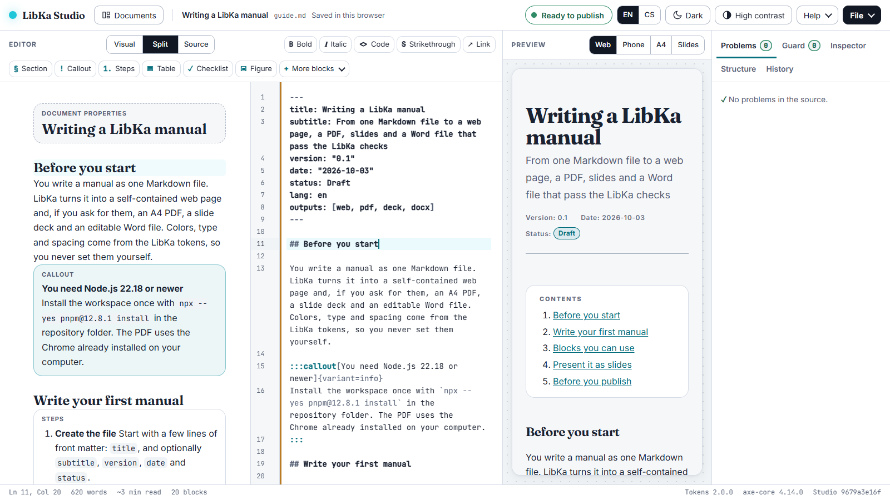

# LibKa Design Platform

[](https://github.com/aivigator-ai/open-libka-design-platform/actions/workflows/check.yml) [](LICENSE) [](docs/admin/environment.md)

**Write a document once in LibKa Markdown. Get a web page, an A4 PDF, 16:9 slides and an editable Word file, each checked for accessibility, with a signed record of what was checked.**

LibKa is a design system (W3C DTCG design tokens) and a document platform. You write one file in LibKa Markdown, Markdown extended with LibKa blocks: steps, callouts, tables, charts, diagrams, timelines, comparisons, release notes and more (35 block types in all). The build renders the outputs the document asks for. **Guard** then checks each one, the pages in a real browser, and signs a manifest of the checks for the outputs that pass. **LibKa Studio** lets anyone write the same documents visually, without touching Markdown.


- **Website:** https://libka.aivigator.ai/
- **Try LibKa Studio in your browser:** https://libka-studio.aivigator.ai/
- **Documentation:** [`docs/`](docs/README.md), starting with [getting started](docs/getting-started.md) and the [block catalog](docs/blocks.md)

> **Status:** version 2.0.2. Developed and tested on Windows; CI runs the full test suite on Linux (Ubuntu) and the health check on Windows; macOS is not tested.

## Why LibKa

Markdown publishing tools already turn one source into web pages, PDFs and slides. LibKa's difference is that it **checks every output and says exactly what it checked**:

- **The rules that can be automated are enforced; the rest is listed for a person:** blocks carry their accessibility rules (an image cannot go in without alternative text), the build stops on problems with `file:line` messages, Guard measures the rendered result in Chrome, not the source, and the conformance report names what a person still has to review.
- **The PDF is repaired and validated:** Chrome's tagged PDFs are repaired for PDF/UA-1 and, when Java and veraPDF are installed, validated by veraPDF, the PDF Association's reference validator, on every rule a machine can check (the rest of PDF/UA, such as a meaningful reading order, needs a person).
- **Every output gets a record:** a signed manifest of the checks and a WCAG 2.2 / EN 301 549 conformance report per build.
- **A design system, not a theme:** colours, type and spacing come from DTCG tokens whose contrast the token build gates, in light, dark and high contrast.
- **Visual editing for people who never touch Markdown,** with the page and Word checks live in LibKa Studio, while the LibKa Markdown stays the single source.

LibKa is a good fit for manuals, guides, policies, reports and decks that must be accessible and consistent. It is not a page-layout tool: you choose blocks, not positions.

## LibKa Studio



An installable web app that keeps documents on your own device: a visual editor, a source editor, or both side by side; a live preview of the web page, phone, A4 and slides; the page and Word checks while you type, with one-click fixes where a fix is safe and plain-word explanations otherwise; versions, a command palette, English and Czech, light, dark and high contrast, offline once opened. The Studio has its own accessibility self-audit ([`docs/acr/studio.md`](docs/acr/studio.md)), tested with the keyboard alone, NVDA, forced colours, reflow and touch emulation.

Run it locally: `npx -y @libka/cli studio`, and open the address it prints.

## Quick start

| You need | For |
|---|---|
| Node.js 22.18 or newer, Google Chrome | Building and checking documents (`libka doctor` says what your computer has) |
| Java 21 and veraPDF ([install without administrator rights](docs/admin/verapdf.md)) | Validating PDFs against PDF/UA-1 (optional for building: without them a PDF is built, and its manifest, its conformance report and `verify` say it was not validated; required by `check.py`) |
| Python 3.12 or newer | Working on LibKa itself (`check.py`) |

Start a project:

```bash
npm create libka@latest my-docs        # add -- --lang cs for the example in Czech
cd my-docs
npm install
npm run build                          # web page, PDF, slides and Word file in dist/, checked and signed
npm run verify                         # the files (the slides too) are the ones that were checked and signed
```

The starter has an example document, `npm run check` (the source only, in a couple of seconds, without a browser), a GitHub Actions workflow that builds and checks every push and pull request with the LibKa Guard action, marking a problem in the source on its line and a finding in an output on its file, and a README of next steps. A document chooses its outputs in its front matter, `outputs: [web, pdf, deck, docx]`; without that line it gets the web page and the PDF. Each project signs with its own key, made by its first build in `.libka/` and trusted in `.libka/trusted-keys.json` ([signing keys](docs/admin/signing-keys.md)).

From a clone of this repository:

```bash
git clone https://github.com/aivigator-ai/open-libka-design-platform.git && cd open-libka-design-platform
npx --yes pnpm@12.8.1 install
node packages/cli/src/libka.ts build examples/manual/guide.md     # the outputs land in examples/manual/dist/
```

## Writing documents

A document is written in LibKa Markdown: Markdown with front matter and LibKa blocks. The file stays `.md` and opens in any text editor; only LibKa renders the blocks, other Markdown viewers show them as plain `:::` lines.

```markdown
---
title: Setting up the router
lang: en
outputs: [web, pdf, docx]
---

## Connect it

:::steps
1. **Plug in the power** The light turns orange.
2. **Connect the cable** Use the yellow port.
:::

:::callout[Before you start]{variant=important}
Keep the box: the Wi-Fi password is on its label.
:::
```

- [`examples/manual/guide.md`](examples/manual/guide.md) is a short example that explains the syntax; [`examples/open-source-guide/guide.md`](examples/open-source-guide/guide.md) is a real, long guide: two of GitHub's Open Source Guides (CC BY 4.0) as a manual and a deck.
- Every block is defined once, in `packages/blocks`: syntax, attributes, a JSON schema, accessibility rules, anti-patterns, and what the web page, PDF, slides and Word file do with it.
- **Slides come from the same file:** every `##` and `###` is a slide, `:::notes` holds speaker notes, and overfull slides are shrunk a little or continued.
- Czech documents (`lang: cs`) get Czech labels and Czech typography.

## What every output gets

- **Checks in a real browser:** axe-core with the WCAG 2.2 A and AA rules; the contrast of every visible text against its real background, 4.5:1 and 7:1 when the reader asks for more contrast; LibKa's structure rules; a page that fits a 320-pixel-wide screen without scrolling sideways (reflow); slides that must fit; a strict Content Security Policy.
- **A PDF validated against PDF/UA-1** (ISO 14289-1) by veraPDF: every rule a machine can check, when Java and veraPDF are installed (otherwise the manifest, the conformance report and `verify` say the PDF was not validated).
- **A Word file with real structure:** headings, lists, footnotes, tables whose header row repeats, pictures with alternative text, the document language; Guard checks its structure and contrast.
- **A signed manifest:** the source, the LibKa version, the hashes of every output and every check result. It proves the files are the ones that were checked and which checks ran; [what it does not prove](docs/admin/signing-keys.md#what-a-signature-proves-and-what-it-does-not) is written down too.
- **A conformance report** listing all 55 WCAG 2.2 A/AA success criteria with their EN 301 549 clauses: checked automatically, failed, needs a person, or not applicable.
- **Byte-identical builds:** the same source gives the same web page and Word file, and the same PDF with the same Chrome version.

**What LibKa does not claim.** Automated checks cover part of accessibility. An output that passes is "checked by these tests", not "accessible" or "compliant": the conformance report says what a person still has to review. The draft report for LibKa's outputs is [`docs/acr/libka-outputs.md`](docs/acr/libka-outputs.md).

## AI authoring

- **Agent Skill** in `.claude/skills/libka-author/`: the workflow, and the exact syntax of every block (generated from the registry).
- **MCP server** `@libka/mcp` (in `packages/mcp`): list and describe blocks, check a document, build it.
- **For Claude Code,** both come as one plugin: `/plugin marketplace add aivigator-ai/open-libka-design-platform`, then `/plugin install libka@libka`. Claude Desktop, claude.ai, the API and other MCP clients: [`docs/ai-tools.md`](docs/ai-tools.md).
- Whatever an AI writes goes through the same checks. Content the document declares as AI-written (an AI summary with its reviewer, an AI badge) is listed in the signed manifest.

## Repository map

| Path | What it is |
|---|---|
| `tokens/`, `libka.resolver.json`, `generate.py` | The DTCG design tokens and their build: CSS, SCSS, Tailwind ([`docs/tokens.md`](docs/tokens.md), [the design-system manual](docs/design-system/manual.md)) |
| `packages/blocks` | The block registry, the catalog and skill-reference generators |
| `packages/model` | LibKa Markdown to typed blocks, with problems by line, each with a code and safe fixes ([`docs/problem-codes.md`](docs/problem-codes.md)) |
| `packages/render` | Web page, slides, charts, slide fitting, Content Security Policy, typography, the block styles |
| `packages/guard` | The browser checks, the Word file checks, the WCAG / EN 301 549 mapping, the signed manifest |
| `packages/pdf`, `packages/docx` | PDF/UA repair and veraPDF validation; the Word file |
| `packages/editor` | Visual editing: the ProseMirror schema, the lossless round-trip with LibKa Markdown, the block commands |
| `packages/cli`, `packages/mcp` | `libka build \| lint \| check \| verify \| studio \| doctor`; the MCP server |
| `packages/create-libka` | The starter, `npm create libka` |
| `npm/`, `plugins/libka`, `.claude-plugin/` | The npm packages' build and the quick-start test; the Claude Code plugin and its marketplace file |
| `apps/studio` | LibKa Studio |
| `examples/`, `docs/` | Examples; the documentation and the maintainer guide |

## Contributing

Issues and pull requests are welcome: read [`CONTRIBUTING.md`](CONTRIBUTING.md) first; AI coding agents start from [`AGENTS.md`](AGENTS.md). Questions and ideas go to Discussions ([`SUPPORT.md`](SUPPORT.md) says what to expect); new blocks and features are listed in [`CHANGELOG.md`](CHANGELOG.md) when they ship. Two things to know up front:

- This repository is published from the maintainers' development repository. An accepted pull request is applied there and comes back with the next release, with you credited as co-author of the release commit and thanked in the changelog.
- Sign off every commit (`git commit -s`). The `Signed-off-by` line certifies the [Developer Certificate of Origin](https://developercertificate.org/): that you may contribute the change under the project's licence. A check on the pull request asks for it; there is no separate agreement to sign.

`check.py` runs everything a pull request must pass: the Python tests, the strict TypeScript type check, every test (Chrome tests included), the token build and a check that no generated file is stale.

## Licence

Apache License 2.0 ([`LICENSE`](LICENSE)); third-party material is listed in [`NOTICE`](NOTICE). The fonts are under the SIL Open Font License. LibKa, LibKa Design Platform and LibKa Studio are the publisher's product names, which the licence does not grant: a modified version you publish needs its own name ([`NOTICE`](NOTICE)).

Created by aivigator.ai
