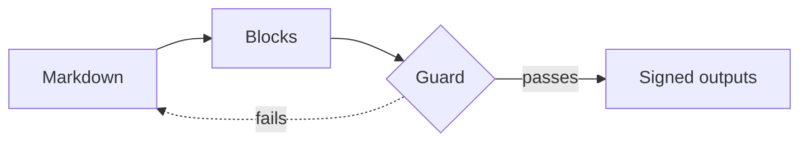
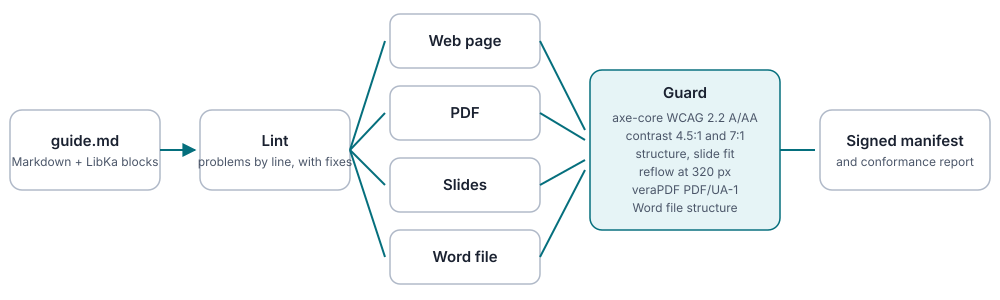

A LibKa document is Markdown plus a few blocks. This page is generated from the block registry (`@libka/blocks`), so it always lists what the tools actually accept, and it is built and checked like any manual.

:::metrics
- **35** blocks in 8 groups
- **4** outputs from one source: web, PDF, slides, Word
- **0** blocks that need a script to be read
:::

:::callout[Nesting]{variant=info}
Blocks that contain other blocks (tabs, accordion, cards, do and don't) get one more colon on the outside: `::::tabs` around `:::tab`.
:::

:::callout[Choose the outputs]{variant=info}
The front matter line `outputs: [web, pdf, deck, docx]` says what the build makes: the web page, its A4 PDF, 16:9 slides and an editable Word file. Without it a document gets the web page and its PDF. The PDF and the Word file are made from the web page and signed with it, so they need `web`.
:::

## Text

### Heading

Sections (##), subsections (###) and minor headings (####). The title comes from the front matter.

**Use it when:** The content has parts a reader scans for or a presenter moves between: one ## per topic, ### per sub-topic (each becomes a slide).

```markdown
## Install the tools

### On Windows
```

*The result is the headings of this page.*

::::accordion
:::item[In each output]
- **Web:** Section heading with an anchor; ## headings make the table of contents.
- **PDF:** Heading and a PDF bookmark.
- **Slides:** ## starts a section slide, ### a slide; #### stays inside its slide.
- **Word:** Heading 1 to 3 (## to ####) with a bookmark; Word builds its Navigation pane from them.
:::
:::item[Accessibility]
- One level at a time: no jump from ## to ####.
- Headings name the content that follows, not decorate it.
:::
:::item[Avoid]
- A heading used for emphasis instead of a callout or statement.
- Headings inside tabs, accordions or cards (they break the outline and the slides).
:::
::::

### Paragraph

Running text with **bold**, *italic*, `code`, links and :kbd[Ctrl+S] keys.

**Use it when:** Explanation, context or argument in sentences. The default; most content is paragraphs.

```markdown
Press :kbd[Ctrl+S] to save. See the [release notes](https://example.org/notes) for details.
```

Press :kbd[Ctrl+S] to save. See the [release notes](https://example.org/notes) for details.

::::accordion
:::item[In each output]
- **Web:** Paragraph, at most 72 characters per line.
- **PDF:** Paragraph.
- **Slides:** Paragraph on the slide.
- **Word:** Paragraph in the Normal style.
:::
:::item[Accessibility]
- Link text says where it goes ("release notes", not "click here").
:::
:::item[Avoid]
- Walls of text on a slide: move them into :::notes.
:::
::::

### List

Bulleted (-) or numbered (1.) lists. For instructions use :::steps, for tasks :::checklist.

**Use it when:** Three or more parallel items without an order (bulleted) or with one (numbered, when not instructions).

```markdown
- Tokens
- Blocks
- Guard
```

- Tokens
- Blocks
- Guard

::::accordion
:::item[In each output]
- **Web:** List.
- **PDF:** List.
- **Slides:** List on the slide.
- **Word:** Word bulleted or numbered list; each list restarts its numbering.
:::
:::item[Accessibility]
- Real list markup, so screen readers announce the number of items.
:::
:::item[Avoid]
- Numbered lists for things without an order.
:::
::::

### Description list

Terms and their values in two columns, such as "Owner: Docs team". Values may hold links, e-mail addresses and code. For terms the reader learns, use :::glossary.

**Use it when:** Key-value facts read as pairs: document or invoice details, specifications, contact data, CV facts.

```markdown
:::dl[Project details]
- **Owner** Platform team
- **Budget** EUR 40,000
- **Deadline** 31 March 2027
:::
```

:::dl[Project details]
- **Owner** Platform team
- **Budget** EUR 40,000
- **Deadline** 31 March 2027
:::

::::accordion
:::item[In each output]
- **Web:** Two columns of terms and values, stacked on phones.
- **PDF:** Same, kept on one page.
- **Slides:** Same, on the slide.
- **Word:** Bold terms, each value indented under its term.
:::
:::item[Accessibility]
- dl/dt/dd markup, so each term is announced with its value.
- The label in brackets captions the list.
:::
:::item[Avoid]
- Long paragraphs as values: use headings and text.
- Data with more than one value per term: use a :::table.
:::
::::

### Speaker notes

What the presenter says. Shown only in the deck (notes panel and presenter view).

**Use it when:** What a presenter should say that does not belong on the slide.

```markdown
:::notes
Mention that the checks run on every build.
:::
```

*Speaker notes are not shown here: they appear only in the deck.*

::::accordion
:::item[In each output]
- **Web:** Not shown.
- **PDF:** Not shown.
- **Slides:** Notes panel (N) and presenter view (P).
- **Word:** Left out: speaker notes belong to the deck.
:::
:::item[Accessibility]
- Never the only place for information the audience needs.
:::
:::item[Avoid]
- Slide text copied into the notes.
:::
::::

## Document

### Document status

Status, owner and review dates. Front matter keys status, owner, reviewed and next-review show them under the title and in the footer by themselves; :::doc-status places them as a panel where you want it (and may set them itself).

**Use it when:** Policies, procedures, specifications and any page readers must trust: who owns it, when it was last reviewed, when the next review is due, and whether it is still valid.

```markdown
:::doc-status{owner="Platform team" reviewed=2026-09-01 next-review=2027-03-01}
:::
```

:::doc-status{owner="Platform team" reviewed=2026-09-01 next-review=2027-03-01}
:::

:::table{caption="Document status: attributes"}

| Attribute | Meaning | Required |
|---|---|---|
| `status` | Draft, Approved, Deprecated ... (or set it in front matter). Deprecated shows a banner at the top. | no |
| `owner` | Who keeps the document correct: a team or a role. | no |
| `reviewed` | Date of the last review, YYYY-MM-DD. | no |
| `next-review` | When the next review is due, YYYY-MM-DD; lint warns once it has passed. | no |

:::

::::accordion
:::item[In each output]
- **Web:** A panel with the status as a badge, the owner and the dates; the same values also appear in the footer.
- **PDF:** Same; the footer line closes the document.
- **Slides:** Title slide footer line.
- **Word:** A shaded panel with the status fields.
:::
:::item[Accessibility]
- A labelled list of terms and values; dates are time elements.
- The status is written out, its badge color only repeats it.
:::
:::item[Avoid]
- The same key in front matter and in the block with different values (reported).
- A next-review date nobody acts on: lint warns when it has passed.
:::
::::

### Table of contents

The contents, placed where it stands: ## sections and parts (depth=2, the default) or also ### subsections (depth=3). It replaces the automatic contents; in a deck it is an agenda.

**Use it when:** Long documents where readers jump to a section, or a deck that opens with an agenda. Manuals already get contents by themselves; place :::toc to choose where they go and how deep.

```markdown
:::toc[Contents]{depth=3}
:::
```

*Not shown here, so this page keeps its contents at the top: the result looks like that list, placed where the block stands.*

:::table{caption="Table of contents: attributes"}

| Attribute | Meaning | Required |
|---|---|---|
| `depth` | 2 lists ## sections and parts, 3 adds ### subsections. One of: `2`, `3`. | no |

:::

::::accordion
:::item[In each output]
- **Web:** A navigation list of links to the headings, nested by level; replaces the automatic contents.
- **PDF:** Printed contents, without page numbers.
- **Slides:** An agenda of the ## sections and parts; its own slide when it comes before the first ##.
- **Word:** Links to the headings, placed here (no Word field, so Word never asks to update it).
:::
:::item[Accessibility]
- A nav landmark named by its title, with a nested list of real links.
:::
:::item[Avoid]
- Contents in a short document with two or three sections.
- Depth 3 on slides: the agenda shows sections only.
:::
::::

### References

The list of cited sources, from the front matter references, in numeric ([1]) or author-date ((W3C, 2023)) style. Without the block, a numeric list is added at the end.

**Use it when:** A report, proposal or study that cites sources with `[@id]`; place the list where it belongs and choose its style. Without the block the list is added at the end.

In the front matter:

```yaml
references:
  - id: wcag22
    title: Web Content Accessibility Guidelines (WCAG) 2.2
    author: W3C
    year: 2023
    url: https://www.w3.org/TR/WCAG22/
```

In the text:

```markdown
Images need a text alternative [@wcag22].

:::references[Sources]{style=author-date}
:::
```

Images need a text alternative [@wcag22].

:::references[Sources]{style=author-date}
:::

:::table{caption="References: attributes"}

| Attribute | Meaning | Required |
|---|---|---|
| `style` | numeric: [1] in the text and a numbered list (default); author-date: (Author, 2023) and a list sorted by author. One of: `numeric`, `author-date`. | no |

:::

::::accordion
:::item[In each output]
- **Web:** A section with the sources; every citation links to its entry.
- **PDF:** Same.
- **Slides:** Where it stands; without the block, a References slide at the end.
- **Word:** Heading 1 and the numbered or alphabetical list; citations link to their entry.
:::
:::item[Accessibility]
- Citations are links with readable text, not bare numbers in color.
- Titles are cite elements; addresses are real links.
:::
:::item[Avoid]
- Sources listed but never cited (reported).
- Citing a source that is not in the list (reported).
:::
::::

### Release notes

One version with its date and its changes in typed groups. Each release is a level-2 heading with an anchor (#v1-4-0), listed in the contents and its own slide. Groups follow the Keep a Changelog order. A notice about the whole release (a paragraph or a callout, such as a dropped platform) may come before the groups; anything that stops working goes in :::removed, anything still working but going away in :::deprecated. The version is written as the source writes it (3.2.0 or v3.2.0).

**Use it when:** Release notes or a changelog: what changed in each version, grouped as added, changed, deprecated, removed, fixed and security (Keep a Changelog).

```markdown
::::release[v1.4.0]{date=2026-10-01}
:::added
- Comparison tables with a recommended column.
:::
:::fixed
- Long code lines no longer overflow in the PDF.
:::
::::
```

::::release[v1.4.0]{date=2026-10-01}
:::added
- Comparison tables with a recommended column.
:::
:::fixed
- Long code lines no longer overflow in the PDF.
:::
::::

:::table{caption="Release notes: attributes"}

| Attribute | Meaning | Required |
|---|---|---|
| `date` | Release date, YYYY-MM-DD (required unless the version is Unreleased). | no |

:::

::::accordion
:::item[In each output]
- **Web:** A version heading with its date, then each group with an icon and its name.
- **PDF:** Same; a group is kept whole when it fits.
- **Slides:** One release per slide.
- **Word:** Heading 1 with the version, the release date, and each group under a bold label.
:::
:::item[Accessibility]
- A real heading per version, so long changelogs can be navigated by headings and the contents.
- Group names are words; icons and colors only repeat them.
:::
:::item[Avoid]
- Commit messages pasted as release notes: write what changed for the reader.
- A release with no groups, or the same group twice (reported).
:::
::::

### Section divider

A part divider: a rule and a large heading, with an optional sentence; break=page starts a new page in print. On slides it is a full section slide.

**Use it when:** A long document or deck with parts or chapters, each grouping several ## sections ("Part 2: Results").

```markdown
:::section[Part 2: Results]{break=page}
What we measured and what changed.
:::
```

*Not shown here, so it does not split this page: the result is a rule and a large heading that also opens a part in the contents.*

:::table{caption="Section divider: attributes"}

| Attribute | Meaning | Required |
|---|---|---|
| `break` | page starts the part on a new page in the PDF. One of: `page`, `none`. | no |

:::

::::accordion
:::item[In each output]
- **Web:** A rule and a large heading; listed in the contents.
- **PDF:** Optional page break before it.
- **Slides:** Full-bleed section slide.
- **Word:** Heading 1 in the accent color, on a new page with break=page.
:::
:::item[Accessibility]
- A real level-2 heading, so it appears in heading navigation and the contents.
:::
:::item[Avoid]
- A divider before every ## section: use it only for parts that group sections.
- Long text inside: one sentence at most.
:::
::::

## How-to

### Code

A fenced code block with an optional file name and highlighted lines; readers get a copy button.

**Use it when:** Commands, file contents, configuration or source code that a reader types or copies.

````markdown
```bash title="build.sh" {2}
npm install --save-dev @libka/cli
npx @libka/cli build guide.md
```
````

```bash title="build.sh" {2}
npm install --save-dev @libka/cli
npx @libka/cli build guide.md
```

:::table{caption="Code: attributes"}

| Attribute | Meaning | Required |
|---|---|---|
| `title` | File name or label shown above the code: title="install.sh". | no |
| `{n,m-k}` | Lines to highlight, e.g. {2} or {1,3-5}. | no |

:::

::::accordion
:::item[In each output]
- **Web:** Code with its file name, highlighted lines and a copy button.
- **PDF:** Code without the button; long lines wrap.
- **Slides:** Code on the slide; keep it short.
- **Word:** Monospace lines in a shaded panel, marked lines in bold, the file name as a caption.
:::
:::item[Accessibility]
- Highlighted lines are marked as such, not only colored.
- The copy button has a text label and announces "Copied".
:::
:::item[Avoid]
- Screenshots of code: they cannot be copied, searched or read aloud.
- More than about 15 lines on a slide.
:::
::::

### Code group

Titled code blocks shown as tabs: each block's title is its tab, and the reader's choice switches every group with the same titles on the page and is remembered for as long as the browser tab is open.

**Use it when:** The same command or snippet in several variants a reader chooses between: npm, pnpm and yarn; Python and JavaScript; Windows and macOS shells.

````markdown
:::code-group
```bash title="npm"
npm install @libka/cli
```
```bash title="pnpm"
pnpm add @libka/cli
```
:::
````

:::code-group
```bash title="npm"
npm install @libka/cli
```
```bash title="pnpm"
pnpm add @libka/cli
```
:::

::::accordion
:::item[In each output]
- **Web:** Keyboard-accessible tabs with one code block each, with copy buttons; groups with the same titles switch together.
- **PDF:** Every variant, one after another, with its title.
- **Slides:** Every variant on the slide, side by side when they are short.
- **Word:** Every variant, each under its bold label.
:::
:::item[Accessibility]
- The WAI-ARIA tabs pattern, as for :::tabs; without script every variant is shown with its title.
:::
:::item[Avoid]
- Variants that differ in more than the tool: write separate steps.
- A group of one block.
:::
::::

### Steps

Numbered instructions, each with a bold title and a description. The text after the bold title is a separate description: write it as a full sentence, or leave it out. To continue a procedure in a second :::steps (on the next slide), start its list at the next number: 4.

**Use it when:** A task the reader performs in order: "Install", "Configure", "Run". Each step starts with a verb.

```markdown
:::steps
1. **Open settings** Choose *Data*, then *Export*.
2. **Run the installer** Keep the default folder.
:::
```

:::steps
1. **Open settings** Choose *Data*, then *Export*.
2. **Run the installer** Keep the default folder.
:::

::::accordion
:::item[In each output]
- **Web:** Numbered flow.
- **PDF:** A step is never split across pages.
- **Slides:** Numbered flow on the slide.
- **Word:** Numbered list with the bold step titles and the descriptions under them; the start number is kept.
:::
:::item[Accessibility]
- An ordered list, so the step count is announced.
:::
:::item[Avoid]
- More than about 7 steps: split the task.
- Steps without a verb in the title.
:::
::::

### Checklist

Tasks that are done or open.

**Use it when:** Things to verify or tasks to tick off, such as "before you publish" or acceptance criteria.

```markdown
:::checklist
- [x] Backup exported
- [ ] Installer downloaded
:::
```

:::checklist
- [x] Backup exported
- [ ] Installer downloaded
:::

::::accordion
:::item[In each output]
- **Web:** List with check marks.
- **PDF:** Kept on one page.
- **Slides:** List on the slide.
- **Word:** One line per task, starting with a checked or an empty box and the word Done or Open.
:::
:::item[Accessibility]
- "Done" and "Open" are spoken, not only shown as icons.
:::
:::item[Avoid]
- A checklist for things that are not tasks.
:::
::::

### Tabs

Alternatives side by side, such as instructions per operating system. Readers pick one; tabs with the same label switch together.

**Use it when:** The same task or content differs by platform, language, role or plan, and each reader needs only one variant.

```markdown
::::tabs
:::tab[Windows]
Run `setup.exe`.
:::
:::tab[macOS]
Open `Setup.dmg`.
:::
::::
```

::::tabs
:::tab[Windows]
Run `setup.exe`.
:::
:::tab[macOS]
Open `Setup.dmg`.
:::
::::

:::table{caption="Tabs: attributes"}

| Attribute | Meaning | Required |
|---|---|---|
| `:::tab label` | Tab name in brackets: :::tab[Windows]. | yes |

:::

::::accordion
:::item[In each output]
- **Web:** Keyboard-accessible tabs (arrow keys); the reader's choice is remembered for as long as the browser tab is open. Without script: one section per tab.
- **PDF:** Every tab, one after another, with its label.
- **Slides:** All tabs side by side.
- **Word:** Every panel, each under its bold label.
:::
:::item[Accessibility]
- The WAI-ARIA tabs pattern: arrow keys, Home and End move between tabs.
- Without script the content is still there, in order.
:::
:::item[Avoid]
- Tabs for content everyone needs: use sections.
- One tab only.
- Tabs inside tabs.
:::
::::

### Accordion / FAQ

Questions or topics that open on demand.

**Use it when:** Questions and answers (FAQ), or optional detail most readers can skip.

```markdown
::::accordion
:::item[Can I print the page?]
Yes: printing shows every answer.
:::
:::item[Does it work offline?]
Yes, every output is one local file.
:::
::::
```

::::accordion
:::item[Can I print the page?]
Yes: printing shows every answer.
:::
:::item[Does it work offline?]
Yes, every output is one local file.
:::
::::

:::table{caption="Accordion / FAQ: attributes"}

| Attribute | Meaning | Required |
|---|---|---|
| `:::item label` | The question or topic: :::item[Question?]. | yes |

:::

::::accordion
:::item[In each output]
- **Web:** Native details and summary: works with keyboard and without script.
- **PDF:** Every item open.
- **Slides:** Every item open.
- **Word:** Every answer, open, under its bold question.
:::
:::item[Accessibility]
- Native details/summary: announced as expandable, opened with Enter or Space.
:::
:::item[Avoid]
- Hiding steps a reader must follow.
- One-word questions: write them as the reader would ask.
:::
::::

### Keyboard shortcuts

A table of keys and what they do.

**Use it when:** Keyboard shortcuts or key combinations and what they do.

```markdown
:::shortcuts{caption="Editor"}
- :kbd[Ctrl+S] Save the draft
- :kbd[Ctrl+Shift+P] Open the command palette
:::
```

:::shortcuts{caption="Editor"}
- :kbd[Ctrl+S] Save the draft
- :kbd[Ctrl+Shift+P] Open the command palette
:::

:::table{caption="Keyboard shortcuts: attributes"}

| Attribute | Meaning | Required |
|---|---|---|
| `caption` | What the shortcuts are for. | yes |

:::

::::accordion
:::item[In each output]
- **Web:** Keys as key caps next to their action.
- **PDF:** Same, kept on one page.
- **Slides:** Same.
- **Word:** Word table with a repeating header row; keys in monospace.
:::
:::item[Accessibility]
- Keys are kbd elements with readable names ("Ctrl", not "^").
:::
:::item[Avoid]
- Shortcuts without the action written out.
:::
::::

## Explain

### Callout

A highlighted message. Status: info, success, warning, error. Guidance: note, tip, important, caution. GitHub alerts (> [!NOTE], [!TIP], [!IMPORTANT], [!WARNING], [!CAUTION]) become callouts too.

**Use it when:** One message the reader must not miss: a prerequisite (info), a risk (warning), a success criterion or a failure; or guidance: a side note, a tip, something important, a caution before an action.

```markdown
:::callout[Back up first]{variant=warning}
Export your data before you upgrade.
:::

> [!TIP]
> The export also works from the command line.
```

:::callout[Back up first]{variant=warning}
Export your data before you upgrade.
:::

> [!TIP]
> The export also works from the command line.

:::table{caption="Callout: attributes"}

| Attribute | Meaning | Required |
|---|---|---|
| `variant` | Meaning of the message. One of: `info`, `success`, `warning`, `error`, `note`, `tip`, `important`, `caution`. | no |

:::

::::accordion
:::item[In each output]
- **Web:** Tinted box with an icon and a title; without a title the tone word ("Tip") is the title.
- **PDF:** Kept on one page.
- **Slides:** Box on the slide.
- **Word:** Shaded panel with a left border in the tone color; the tone word starts the title.
:::
:::item[Accessibility]
- role="note"; every tone has its own icon shape and its word is read out first ("Warning: Back up first"), so color is never the only cue.
:::
:::item[Avoid]
- More than 2 callouts in one section: they stop standing out (lint hints).
- Choosing the variant for its color.
:::
::::

### Glossary

Terms and their definitions; each term can be linked to (#term).

**Use it when:** Terms the audience may not know, defined once and linkable.

```markdown
:::glossary
- **Token** A named design decision, such as a color or a spacing step.
- **Guard** The checks every output passes before it is signed.
:::
```

:::glossary
- **Token** A named design decision, such as a color or a spacing step.
- **Guard** The checks every output passes before it is signed.
:::

::::accordion
:::item[In each output]
- **Web:** Definition list; every term has an anchor.
- **PDF:** Definition list.
- **Slides:** Definition list on the slide.
- **Word:** Bold terms with bookmarks (links reach them), definitions indented.
:::
:::item[Accessibility]
- dl/dt/dd markup, so the term and its definition are announced together.
:::
:::item[Avoid]
- Defining words every reader knows.
- Definitions that use the term itself.
:::
::::

### Diagram

A Mermaid diagram written as text in a ```mermaid fence, drawn as SVG when the document is built. accTitle (the caption) and accDescr (the description for readers who cannot see it) are required. LibKa sets the colours and fonts, so they follow the light, dark and high-contrast themes.

**Use it when:** A process, a sequence of messages, states and transitions, a class model or a data model that a picture explains better than a list: flowcharts, sequence, state, class and entity-relationship diagrams.

````markdown

````


::::accordion
:::item[In each output]
- **Web:** An inline SVG with its caption; "Show the source" reveals the Mermaid text. No script at runtime.
- **PDF:** The same SVG.
- **Slides:** The SVG in the space left under the heading and text (up to 420px high); wide slides suit flowchart LR. Below 200px Guard reports the slide as too full.
- **Word:** Picture drawn in Chrome with the description as alternative text; the source in a Diagram sources appendix.
:::
:::item[Accessibility]
- The SVG is an image named by accTitle and described by accDescr; write the description as the steps a reader would otherwise see.
- Shapes and dotted or solid lines carry meaning, not colour.
:::
:::item[Avoid]
- A diagram for a simple linear process: use :::steps.
- Colour statements (style, classDef, linkStyle) and init blocks (reported).
- Diagrams too detailed to read on a slide: split them.
:::
::::

### Do and don't

Good and bad examples next to each other.

**Use it when:** Guidance with a right and a wrong way: writing style, UI labels, design rules.

```markdown
::::compare
:::do[Name the action]
"Save draft"
:::
:::dont[Use vague labels]
"OK" or "Click here"
:::
::::
```

::::compare
:::do[Name the action]
"Save draft"
:::
:::dont[Use vague labels]
"OK" or "Click here"
:::
::::

:::table{caption="Do and don't: attributes"}

| Attribute | Meaning | Required |
|---|---|---|
| `:::do label` | What to do. | yes |
| `:::dont label` | What to avoid. | yes |

:::

::::accordion
:::item[In each output]
- **Web:** Side by side, each marked "Do" or "Don't" in words and with an icon.
- **PDF:** Side by side, kept on one page.
- **Slides:** Side by side.
- **Word:** A shaded panel for Do and one for Do not, each with its mark and color.
:::
:::item[Accessibility]
- "Do" and "Don't" are written, never shown by color alone.
:::
:::item[Avoid]
- A don't without a do: always show the better way.
:::
::::

### Quote

A quotation, with its source when it has one. A plain Markdown > quote works too.

**Use it when:** Words from a person or a source, quoted with attribution: a customer, a standard, a law.

```markdown
:::quote{source="Web Content Accessibility Guidelines 2.2" cite="https://www.w3.org/TR/WCAG22/"}
Content can be presented in different ways without losing information or structure.
:::
```

:::quote{source="Web Content Accessibility Guidelines 2.2" cite="https://www.w3.org/TR/WCAG22/"}
Content can be presented in different ways without losing information or structure.
:::

:::table{caption="Quote: attributes"}

| Attribute | Meaning | Required |
|---|---|---|
| `source` | Who or what is quoted. | no |
| `cite` | Link to the source. | no |

:::

::::accordion
:::item[In each output]
- **Web:** Quotation with its source underneath.
- **PDF:** Same.
- **Slides:** Large quotation.
- **Word:** Quote style with a left border; the source after a dash, linked when it has an address.
:::
:::item[Accessibility]
- blockquote with cite; the source is text, not only a link.
:::
:::item[Avoid]
- Quotes used as decoration or for emphasis.
- Quotes without a source when they have one.
:::
::::

## Highlight

### Cards

A grid of related topics or links, each with a title and a short text.

**Use it when:** Pointers to related pages, products, options or next steps, each with a title and one sentence.

```markdown
::::cards
:::card[Code]{href="#code"}
File names, highlighted lines and a copy button.
:::
:::card[Charts]{href="#chart" badge="New"}
Bar, line and donut charts drawn from a table.
:::
::::
```

::::cards
:::card[Code]{href="#code"}
File names, highlighted lines and a copy button.
:::
:::card[Charts]{href="#chart" badge="New"}
Bar, line and donut charts drawn from a table.
:::
::::

:::table{caption="Cards: attributes"}

| Attribute | Meaning | Required |
|---|---|---|
| `:::card label` | Card title. | yes |
| `:::card href` | Where the card leads. | no |
| `:::card badge` | A short label, such as "New". | no |

:::

::::accordion
:::item[In each output]
- **Web:** Grid of cards; a linked card is clickable as a whole, the title is the link.
- **PDF:** Grid; links stay links.
- **Slides:** Grid on the slide.
- **Word:** One bordered panel per card: badge, title (a link when the card has one) and text.
:::
:::item[Accessibility]
- A list of cards; one link per card (its title), not a link around everything.
:::
:::item[Avoid]
- More than about 6 cards in one grid.
- Cards with only a title.
:::
::::

### Statement

One key message in large type. Made for slides; at most 30 words.

**Use it when:** The single most important message of a section or slide, in one sentence.

```markdown
:::statement
Every page is checked before it is published.
:::
```

:::statement
Every page is checked before it is published.
:::

::::accordion
:::item[In each output]
- **Web:** Large text with an accent line.
- **PDF:** Same.
- **Slides:** Fills the slide when it is the slide's only content.
- **Word:** A larger paragraph in the brand font.
:::
:::item[Accessibility]
- Plain paragraph text: it is read as written.
:::
:::item[Avoid]
- More than one statement per section.
- Long sentences: a statement over 30 words is reported.
:::
::::

### Key figures

Two to four numbers with what they mean.

**Use it when:** Two to four headline numbers with what they mean: results, targets, KPIs.

```markdown
:::metrics
- **4** outputs from one file
- **7:1** text contrast in high contrast
- **0** third-party requests
:::
```

:::metrics
- **4** outputs from one file
- **7:1** text contrast in high contrast
- **0** third-party requests
:::

::::accordion
:::item[In each output]
- **Web:** Numbers in large type with their labels.
- **PDF:** Same.
- **Slides:** Same, in a row.
- **Word:** Each figure large and bold, its label under it.
:::
:::item[Accessibility]
- Number and label are read together, in that order.
:::
:::item[Avoid]
- Numbers without context ("98 %" of what?).
- More than 4 figures.
:::
::::

### Summary

Key takeaways in a box, 3 to 5 points. source=ai with reviewed-by shows an "AI-assisted, reviewed by …" label.

**Use it when:** Three to five key points a busy reader needs first: the top of a report, a proposal or a long page. Mark it source=ai when an AI wrote it, with the person who checked it.

```markdown
:::summary[Key takeaways]{source=ai reviewed-by="Docs lead"}
- Every page passes the accessibility checks before it is signed.
- One Markdown file gives the web page, the PDF and the slides.
- The block catalog is generated, so it never drifts from the tools.
:::
```

:::summary[Key takeaways]{source=ai reviewed-by="Docs lead"}
- Every page passes the accessibility checks before it is signed.
- One Markdown file gives the web page, the PDF and the slides.
- The block catalog is generated, so it never drifts from the tools.
:::

:::table{caption="Summary: attributes"}

| Attribute | Meaning | Required |
|---|---|---|
| `source` | Who wrote the summary: human (default) or ai. One of: `human`, `ai`. | no |
| `reviewed-by` | Name of the person who checked an AI summary, optionally with the role (required with source=ai). | no |

:::

::::accordion
:::item[In each output]
- **Web:** A labelled box with the points and, for AI summaries, the AI label.
- **PDF:** Kept on one page.
- **Slides:** Its own slide when it comes before the first ## section; otherwise a box on its slide.
- **Word:** Shaded panel with the title and a bulleted list; AI-assisted with the reviewer when source=ai.
:::
:::item[Accessibility]
- A region named by its title, with a real list.
- The AI label is text ("AI-assisted, reviewed by …"), not only a badge color.
:::
:::item[Avoid]
- More than 5 points: it stops being a summary.
- Points that repeat the headings instead of the findings.
- An AI summary nobody reviewed (reported).
:::
::::

### Call to action

A link styled as a button, with an optional sentence before it. In print and on slides the address is written out.

**Use it when:** The one next step at the end of a section, page or deck: start the tutorial, book a demo, download the template.

```markdown
:::cta[Start the tutorial]{href="https://example.org/tutorial"}
It takes about ten minutes.
:::
```

:::cta[Start the tutorial]{href="https://example.org/tutorial"}
It takes about ten minutes.
:::

:::table{caption="Call to action: attributes"}

| Attribute | Meaning | Required |
|---|---|---|
| `href` | Where the action leads: an address, a file or #a-heading. | yes |
| `variant` | primary for the main action (default), secondary for an alternative. One of: `primary`, `secondary`. | no |

:::

::::accordion
:::item[In each output]
- **Web:** A link that looks like a button (it navigates, so it is not a button element).
- **PDF:** The label with its address written out.
- **Slides:** The button with its address written out.
- **Word:** The label as a link, the address written out after it.
:::
:::item[Accessibility]
- A real link whose label says what happens ("Start the tutorial", not "Click here").
- At least 44 px high.
:::
:::item[Avoid]
- More than one primary action per section.
- Vague labels: "Click here", "More", "Learn more" are reported.
:::
::::

## Media

### Figure

An image with alt text and a caption, on its own line.

**Use it when:** A diagram, screenshot, photo or illustration that carries information.

```markdown

```


::::accordion
:::item[In each output]
- **Web:** Image with its caption.
- **PDF:** Kept on one page.
- **Slides:** Image on the slide.
- **Word:** Picture with the alt text, the caption under it; an SVG is drawn as PNG; an image from the web shows its alt text instead.
:::
:::item[Accessibility]
- Alt text says what the image shows; the caption says why it is there.
:::
:::item[Avoid]
- Images of text.
- Alt text that repeats the caption.
:::
::::

### Gallery

Several images with captions in a grid.

**Use it when:** Several related images to compare or browse, each with its own caption.

```markdown
:::gallery


:::
```

:::gallery


:::

::::accordion
:::item[In each output]
- **Web:** Responsive grid of figures.
- **PDF:** Grid, kept on one page when it fits.
- **Slides:** Grid on the slide.
- **Word:** Every image as a figure.
:::
:::item[Accessibility]
- Every image has its own alt text and caption.
:::
:::item[Avoid]
- Decorative galleries: use images that carry information.
:::
::::

### Video

A video with captions and a transcript. YouTube and Vimeo load only after the reader asks for them.

**Use it when:** A recording that shows something better than text: a walkthrough, a demo, a talk.

```markdown
:::video[Big Buck Bunny, an open film by the Blender Foundation]{src="https://www.youtube.com/watch?v=aqz-KE-bpKQ"}
A short animated film without dialogue: a large rabbit enjoys a quiet day in the forest until three rodents start to tease him.
:::
```

:::video[Big Buck Bunny, an open film by the Blender Foundation]{src="https://www.youtube.com/watch?v=aqz-KE-bpKQ"}
A short animated film without dialogue: a large rabbit enjoys a quiet day in the forest until three rodents start to tease him.
:::

:::table{caption="Video: attributes"}

| Attribute | Meaning | Required |
|---|---|---|
| `src` | A video file (mp4, webm) or a YouTube or Vimeo address. | yes |
| `captions` | WebVTT captions for a video file (required for files). | no |
| `poster` | Image shown before the video plays. | no |

:::

::::accordion
:::item[In each output]
- **Web:** Video player without autoplay; YouTube and Vimeo appear behind a "Play" button and load (privacy-enhanced) only on click. Transcript underneath.
- **PDF:** Title, link and transcript.
- **Slides:** Player on the slide.
- **Word:** A link to the video, then the transcript under a bold label.
:::
:::item[Accessibility]
- Captions for video files; a transcript for every video.
- No autoplay; the play button names the video and the provider.
:::
:::item[Avoid]
- Autoplaying or looping video.
- Video as the only way to get the information.
:::
::::

## Data

### Table

A Markdown table with a caption.

**Use it when:** Data with rows and columns that readers look up or compare: versions, prices, specifications.

```markdown
:::table{caption="Supported versions"}
| Version | Supported until |
|---|---|
| 2.1 | 2027 |
:::
```

:::table{caption="Supported versions"}
| Version | Supported until |
|---|---|
| 2.1 | 2027 |
:::

:::table{caption="Table: attributes"}

| Attribute | Meaning | Required |
|---|---|---|
| `caption` | What the data shows. | yes |

:::

::::accordion
:::item[In each output]
- **Web:** Table with column headers; scrolls sideways on small screens.
- **PDF:** Header row repeats on every page.
- **Slides:** Table on the slide.
- **Word:** Word table with a header row that repeats on every page; the caption above it and as its alternative text.
:::
:::item[Accessibility]
- caption and th scope="col".
:::
:::item[Avoid]
- Tables for layout.
- A table where a chart shows the point better (or the other way round).
:::
::::

### Timeline

Dates or periods with what happens, in order; each item starts with the date in bold. current= marks one item with the word "Now"; items before it read as past, items after it as planned, so drop labels such as "(done)".

**Use it when:** Dated events or phases in order: a roadmap, a project plan, a history, CV experience. Mark where things stand now with current=.

```markdown
:::timeline[Office move]{current="2026-Q2"}
- **2026-Q1** Lease signed for the new office
- **2026-Q2** Fit-out and furniture
- **2026-Q3** Teams move in
:::
```

:::timeline[Office move]{current="2026-Q2"}
- **2026-Q1** Lease signed for the new office
- **2026-Q2** Fit-out and furniture
- **2026-Q3** Teams move in
:::

:::table{caption="Timeline: attributes"}

| Attribute | Meaning | Required |
|---|---|---|
| `current` | The date of the current item, exactly as written in bold: current="2026-Q2". | no |

:::

::::accordion
:::item[In each output]
- **Web:** A vertical line of dates and text; the current item is marked "Now".
- **PDF:** Vertical, items kept whole.
- **Slides:** Horizontal, up to about 6 items (lint hints above that).
- **Word:** Bold dates (the current one marked Now), each item indented under its date.
:::
:::item[Accessibility]
- An ordered list; dates are time elements when they are calendar dates (2026, 2026-03, 2026-03-15).
- "Now" is written; past and planned items are named for screen readers, not shown by color alone.
:::
:::item[Avoid]
- A timeline for steps a reader performs: use :::steps.
- More than about 6 items on a slide: split it or use a table.
:::
::::

### Comparison table

A table of options against features with one column highlighted. Cells written yes, no or partial (or ✓ ✗ ~) show an icon and the words "Included", "Not included" or "Partly"; a qualifier may follow after a bracket, comma or colon (partial (50 per month), yes, up to 5). Any other text, such as a price, is shown as written.

**Use it when:** Options, plans or products compared feature by feature, often with one recommended: pricing plans, tool choices, vendor offers.

```markdown
:::comparison[Laptops for the team]{highlight=Standard}
| Feature | Basic | Standard | Pro |
|---|---|---|---|
| 16 GB memory | yes | yes | yes |
| Second screen | no | yes | yes |
| On-site repair | no | partial | yes |
| Price | EUR 700 | EUR 1,100 | EUR 1,600 |
:::
```

:::comparison[Laptops for the team]{highlight=Standard}
| Feature | Basic | Standard | Pro |
|---|---|---|---|
| 16 GB memory | yes | yes | yes |
| Second screen | no | yes | yes |
| On-site repair | no | partial | yes |
| Price | EUR 700 | EUR 1,100 | EUR 1,600 |
:::

:::table{caption="Comparison table: attributes"}

| Attribute | Meaning | Required |
|---|---|---|
| `highlight` | The heading of the recommended column, exactly as written: highlight=Team. That column gets a border and a visible "Recommended" badge, so do not write "recommended" yourself. | no |
| `badge` | The badge text when the source says something else than "Recommended": badge="Most popular" (needs highlight). | no |

:::

::::accordion
:::item[In each output]
- **Web:** A table with row and column headers; the highlighted column has a border and the word "Recommended".
- **PDF:** Same; the header row repeats on every page.
- **Slides:** Same, on the slide (at most 4 options).
- **Word:** Word table with a repeating header row; the recommended column named in its header; marks as words.
:::
:::item[Accessibility]
- A real table with column and row headers.
- Yes, no and partial are icons with visible words, never icons or color alone; the highlight is named in words.
:::
:::item[Avoid]
- More than 4 options (reported): they do not fit a slide or a phone.
- Marketing words in the cells instead of facts.
:::
::::

### Chart

A bar, line or donut chart drawn from a Markdown table; the table stays available as the accessible version.

**Use it when:** Numbers whose pattern matters: comparisons between categories (bar), change over time (line), parts of a whole (donut).

```markdown
:::chart{type=bar caption="Staff who find the handbook easy to use" unit="%"}
| Quarter | 2025 | 2026 |
|---|---|---|
| Q1 | 62 | 71 |
| Q2 | 64 | 75 |
| Q3 | 66 | 78 |
:::
```

:::chart{type=bar caption="Staff who find the handbook easy to use" unit="%"}
| Quarter | 2025 | 2026 |
|---|---|---|
| Q1 | 62 | 71 |
| Q2 | 64 | 75 |
| Q3 | 66 | 78 |
:::

:::table{caption="Chart: attributes"}

| Attribute | Meaning | Required |
|---|---|---|
| `type` | Bar for comparison, line for trends, donut for parts of a whole (one series, at most 5 parts). One of: `bar`, `line`, `donut`. | yes |
| `caption` | What the chart shows. | yes |
| `unit` | Unit of the values, such as % or €. | no |

:::

::::accordion
:::item[In each output]
- **Web:** SVG chart in the series colors with pattern fills, value labels and a legend; "Show data" opens the table.
- **PDF:** Chart and the data table.
- **Slides:** Chart on the slide.
- **Word:** Picture drawn in Chrome with the summary as alternative text, then the data as a Word table.
:::
:::item[Accessibility]
- Hue is never the only encoding: patterns for bars and slices, marker shapes for lines.
- The chart has a title and a text summary; the full data is a real table.
- Axes start at zero.
:::
:::item[Avoid]
- 3D, decorative gradients and animation on load.
- Donuts with more than 5 parts.
- More than 6 series.
:::
::::

## UI specimens

### UI specimen

Real LibKa components shown as they look (light, dark or both), for manuals, product docs and specs. Inert: they illustrate, they do not act.

**Use it when:** Documenting or specifying an interface: which button, field, message or dialog the reader will see.

```markdown
:::ui{caption="Saving a draft: one primary action" theme=both}
::button[Save draft]{variant=primary}
::button[Preview]{variant=secondary}
::button[Delete]{variant=destructive state=disabled}
:::
```

:::ui{caption="Saving a draft: one primary action" theme=both}
::button[Save draft]{variant=primary}
::button[Preview]{variant=secondary}
::button[Delete]{variant=destructive state=disabled}
:::

:::table{caption="UI specimen: attributes"}

| Attribute | Meaning | Required |
|---|---|---|
| `caption` | What the specimen shows. | yes |
| `theme` | Show it in the light theme, the dark theme or both side by side. One of: `light`, `dark`, `both`. | no |
| `layout` | Components in a row (default) or stacked. One of: `row`, `stack`. | no |
| `:::button label` | Button text, a verb: ::button[Save draft]. | yes |
| `:::button variant` | Manual 10.1. One of: `primary`, `accent`, `iris`, `secondary`, `destructive`, `ghost`. | no |
| `:::button state` | Manual 10.1 states. One of: `default`, `hover`, `focus`, `disabled`, `loading`. | no |
| `:::field label` | Visible label: ::field[Email]. | yes |
| `:::field type` | Kind of input. One of: `text`, `email`, `password`, `number`, `textarea`, `select`, `checkbox`, `radio`, `switch`. | no |
| `:::field value` | Filled-in value (or the selected option). | no |
| `:::field placeholder` | Example text; never instead of the label. | no |
| `:::field hint` | Helper text under the field. | no |
| `:::field error` | Error message: specific and recoverable. | no |
| `:::field options` | Choices for select and radio, separated by \|. | no |
| `:::field state` | Manual 10.2 states. One of: `default`, `hover`, `focus`, `disabled`, `readonly`. | no |
| `:::field required` | Marks the field as required. | no |
| `:::badge label` | Short status: ::badge[Beta]. | yes |
| `:::badge variant` | Meaning. One of: `neutral`, `info`, `success`, `warning`, `error`, `ai`. | no |
| `:::toast label` | The message title: ::toast[Draft saved]. | yes |
| `:::toast variant` | Meaning. One of: `info`, `success`, `warning`, `error`. | no |
| `:::toast text` | One sentence of detail. | no |
| `:::toast action` | One action, such as Undo. | no |
| `:::modal label` | Dialog title: ::modal[Delete the draft?]. | yes |
| `:::modal text` | What happens, in one or two sentences. | yes |
| `:::modal primary` | Label of the main action. | yes |
| `:::modal secondary` | Label of the way out, such as Cancel. | no |
| `:::modal destructive` | The main action removes something (red). | no |
| `:::empty label` | Empty state title: ::empty[No projects yet]. | yes |
| `:::empty text` | Why it is empty and what to do. | yes |
| `:::empty action` | The one action that fills it. | no |

:::

::::accordion
:::item[In each output]
- **Web:** Components in a framed stage, light and/or dark, with the caption and a text description for screen readers.
- **PDF:** Same, in color.
- **Slides:** Same, on the slide.
- **Word:** Picture of the specimen (both themes when asked) with its description as alternative text.
:::
:::item[Accessibility]
- The stage is inert and hidden from screen readers; a generated text describes every component instead.
- Components keep their real contrast in both themes and in high contrast (Guard checks the specimen like any text).
- Disabled specimens are marked as such, so their lower contrast is allowed.
:::
:::item[Avoid]
- Screenshots of UI: they go stale and cannot be checked.
- More than one primary button for one decision.
- Placeholder text instead of a label.
:::
::::

## Inside text

### Key

Keys and key combinations as key caps; + separates the keys.

```markdown
Press :kbd[Ctrl+Shift+P].
```

Press :kbd[Ctrl+Shift+P].

### Badge

A short status label inside text: neutral, info, success, warning, error or ai.

```markdown
Export to PowerPoint :badge[Beta]{variant=info}
```

Export to PowerPoint :badge[Beta]{variant=info}

### Footnote

An aside or a source without breaking the sentence: `[^name]` in the text and `[^name]: the note` on its own line at the top level (the end of the document is best). Notes are numbered by first use and collected under Notes at the end; decks get a Notes slide. Every note must be used and every reference defined.

```markdown
Contrast is measured on the rendered page.[^contrast]

[^contrast]: Guard also measures with high contrast requested.
```

Contrast is measured on the rendered page.[^contrast]

[^contrast]: Guard also measures with high contrast requested.

### Citation

A source from the front matter references list: `[@id]`, with a page or section after a comma (`[@id, p. 33]`), several separated by ; (`[@a; @b]`). Shown as [1] or (Author, 2023) by the `:::references` style, linked to the list. Recognised only when the front matter has references.

```markdown
Text alternatives are required for images [@wcag22, sec. 1.1.1].
```

Text alternatives are required for images [@wcag22, sec. 1.1.1].

